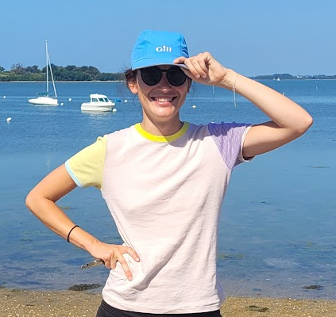
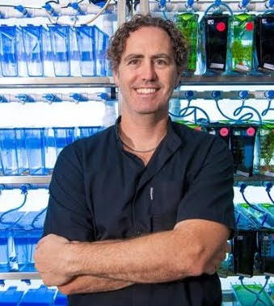
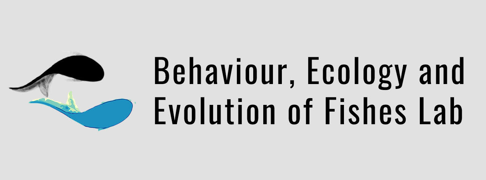
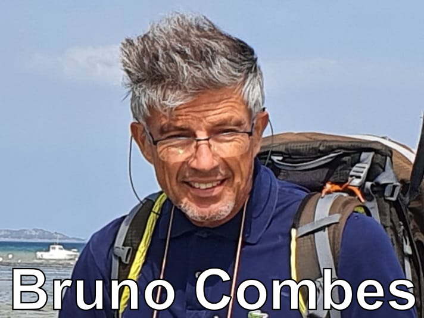

## Juliette Tariel-Adam

::: {.investigators-img-big}

::: 

I am an early-career researcher interested in the evolution, behaviour and cognition of fishes. I want to understand why fish behave the way they do, and studying their evolution provides me with many answers. I hold a PhD in Evolutionary Biology from Claude Bernard Lyon 1 University in France. I am currently a postdoctoral researcher at Macquarie University in Australia. 

  [Personal website](https://juliettetarieladam.github.io/){target="_blank"}

## Culum Brown

::: {.investigators-img-big}

::: 

Culum is an international superstar in fish, shark and ray research. He has published more than 170 articles and 14 book chapters on their behaviour and cognition, which have been cited more than 10,000 times. He has applied his knowledge to improve the welfare and conservation of these animals in a wide range of contexts: fisheries, aquaculture, zoos, aquariums and research facilities. He has been a professor at Macquarie University since 2019.

 [Lab website](https://thefishlab.com/PI.html){target="_blank"}

# Where do we work?

::: { layout-ncol=2 .investigators-img-small}

{target="_blank"}

:::

# Who funds this project?
We are grateful to the funders of this project:

::: {layout-ncol=2 .investigators-img-small}

{target="_blank"}

{target="_blank"}

{target="_blank"}

:::