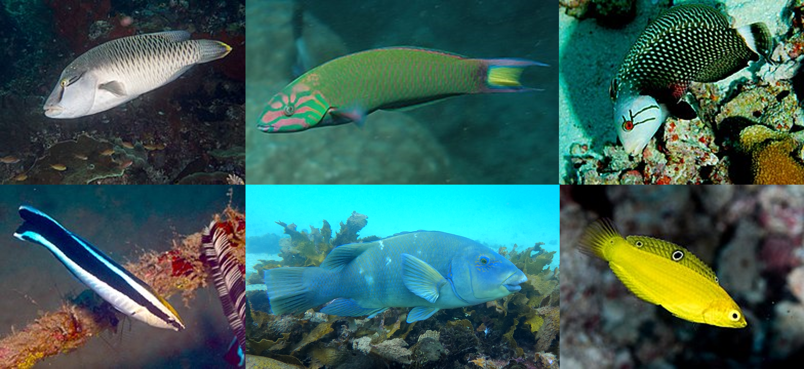

::: {.callout-note} 

## The project has three main aims: 

1. Build fundamental knowledge of anvil use by fish.
2. Help answer one of the most intriguing questions in tool-use research: why do some animals use tools while others do not?
3. Raise awareness of fish tool use and intelligence as an indirect way to promote their protection.

Read on to learn more about each aim.
:::

::: {.callout-note} 
## How will we achieve these aims?

To achieve these aims, we need to collect new observations of anvil use by fish. I am using two methods:

1. [Community science]{.highlight-blue}, also known as citizen science.  I will connect with many people to raise awareness of fish tool use and encourage them to report their observations. If you have seen a fish striking its prey against a rock, you can report your observation [here](report.qmd). I will also create Instagram posts highlighting fish intelligence and behaviour.

2. [Fieldwork]{.highlight-blue}. In 2024, we conducted two fieldwork campaigns: one in Exmouth, Western Australia, and another in Sydney. We managed to induce the anvil-use behaviour in fish and capture it on video! This was only successful in fully sanctuary zones where fish weren't scared of humans. 

:::

# 🐟 Project aim 1

> Build fundamental knowledge about anvil use by fish

In our research project, we focused on one type of tool use known as anvil use. When using an anvil, the fish grabs a prey item (typically an urchin or clam) in its mouth, swims to a specific rock/coral and uses it as an anvil by rapidly and repeatedly bashing the prey item until it breaks. It is a case of tool use as the fish uses an external object to achieve an immediate goal (see more about the definition of tool use on the website [here](tooluse.qmd)). We believe that the behaviour extends the fish's physical capabilities: It would not be able to crack this clam with its teeth! And it may limit the damage in the mouth from broken shells or urchins. 



[One of the few videos available from the literaure (Harbone and Tholan 2016)]{.legend}

Apart from a few snorkelling surveys conducted by Kimberley Pryor, fish anvil use has never been studied. Most of the scientific literature consists of written descriptions of a small number of fish, often from a single location. As a result, fundamental questions about this behaviour remain unanswered such as: Which species are able to use rocks as anvils to open their prey? Do fish use different techniques? Do all individuals of a species use tools, or only one sex or at a certain period in their lives? That's why the first aim of the project is to document anvil use in fish. 

# 🤔 Project aim 2

> Why don’t all animals use tools? 

Have you ever wondered why humans are able to use tools? Is it because of our big brain? Our capacity to move objects precisely with our hands? In other words, what are the factors needed for an animal to evolve tool use? It is a difficult question to answer because we cannot travel back in time to observe what features humans or other animals had when they start using tools. Instead, we can identify species that use tools, compare them with closely related species that do not, and look for general patterns. For example, do tool-using species tend to have larger brains, particular anatomical features, specific diets, or certain social systems? A characteristic that repeatedly occurs in tool-using species could help explain how and why tool use evolves. This approach is known as comparative phylogenetic analysis. “Comparative” means that we compare different species. “Phylogenetic” means that we account for how closely those species are related through evolution.

{fig-alt="A fake phylogenetic tree to illustrate comparative analysis"}

The problem is that tool use is a rare behaviour in the animal kingdom. It is impossible to draw general trends from a few occurrences! That is why we need to explore tool use in all vertebrate species, including fish. Anvil use by fish offers a promising system for testing hypotheses about the evolution of tool use. So far, anvil use has been described in 25 fish species in the scientific literature. All of these species are wrasses, also known as labrids because they belong to the family Labridae.

With more than 600 species, Labridae is an exceptionally large and diverse family. Wrasses vary considerably in their ecology, diet, morphology, behaviour, and life history. This diversity creates a great opportunity for comparative analysis for two main reasons: (1) Anvil use may have evolved on multiple occasions across the evolutionary history of wrasses; (2) Wrasse species differ in many of the characteristics that could potentially influence tool use. Variation is essential for comparative research. If all species shared the same characteristics, it would be impossible to identify what distinguishes tool-using species from species that do not use tools. By studying wrasses, we may be able to identify the cognitive, physical, and ecological factors associated with the evolution of tool use. Ultimately, this could help explain why tool use remains rare despite the substantial advantages it can provide.

# Project aim 3

> Change the way people think about fish intelligence

The third aim of the project is to challenge the widespread perception that fish are simple or unintelligent animals. Fish possess sophisticated cognitive abilities, many of which remain underestimated. Fish can learn, solve problems, navigate complex environments, recognise other individuals, recognise themselves in the mirror, and adapt their behaviour to changing conditions. Tool use provides another striking example of this behavioural flexibility. By sharing observations of anvil use, we hope to show that fish behaviour is more complex than many people realise.

::: {.callout-note} 
## To learn more about fish cognition

+ Explore this free [e-learning Smart Fish](https://www.mvls.gla.ac.uk/Teaching/SmartFish/story_html5.html) resource
+ Read this [Australian Geographic article](https://www.australiangeographic.com.au/nature-wildlife/2020/01/underwater-and-underrated-the-truth-behind-fish-intelligence/)

:::

<!-- Another goal of the project is to deconstruct the image of fish as stupid. Fish are intelligent animals. Their cognitive abilities are far beyond what most people think, other matching or outstanding the ones from mammals. Check out this free [e-learning](https://www.mvls.gla.ac.uk/Teaching/SmartFish/story_html5.html) or this [article from Australian Geographic magazine](https://www.australiangeographic.com.au/nature-wildlife/2020/01/underwater-and-underrated-the-truth-behind-fish-intelligence/) to learn more about how smart are fish. -->
