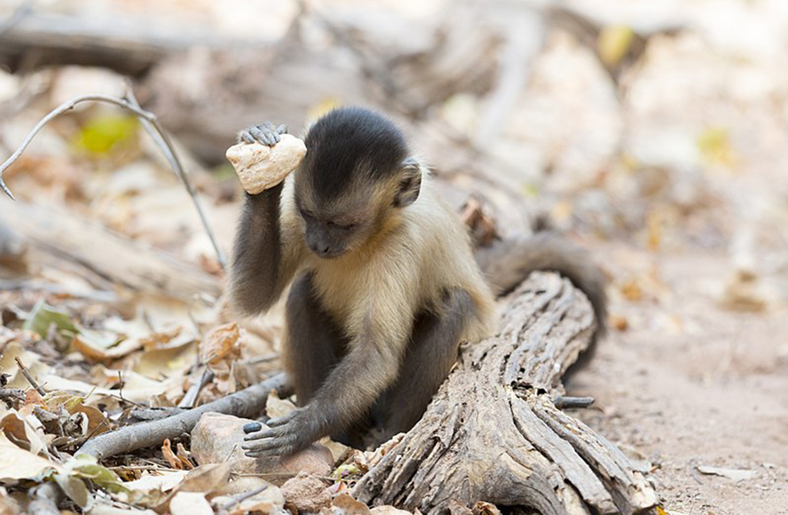
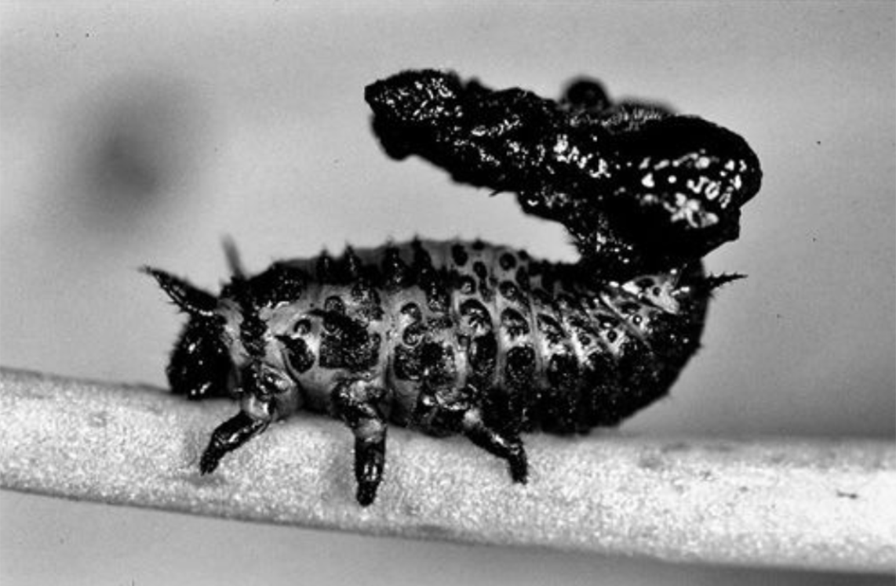
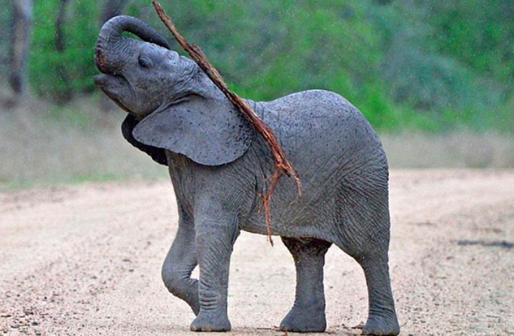
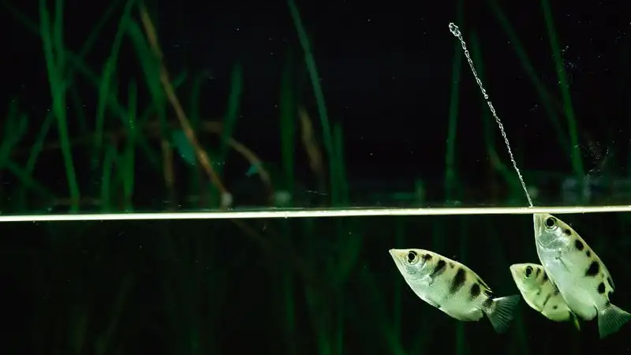

We use tools every day: cars, hairbrushes, plastic boxes. Tools are all around us. [But other animals use tools too!]{.highlight-blue} Tool use has been observed in a wide range of animals: primates, birds, fish, insects, crustaceans, cephalopods, etc. Animals use tools mainly to gain access to new foods, but also to protect themselves from predators and so on.

::: {layout-ncol=4}

:::

# 🤔️ What does it mean to use a tool?
There have been controversies about the definition of tool use. The first definition was from Jane Goodall in 1971: *"Tool use is the use of an external object as a functional extension of mouth or beak, hand or claw, in the attainment of an immediate goal"*. Then a lot of researchers have revisited it to give a better definition and it sometimes ended up in quite complicated definitions... *"Tool use is the external employment of an unattached environmental object to alter more efficiently the form, position, or condition of another object, another organism, or the user itself when the user holds or carries the tool during or just prior to use and is responsible for the proper and effective orientation of the tool"* 🥵 (Beck 1980).

This shows that defining tool use is tricky. Even with Jane Goodall's first simple definition: 1) What is an object? Some researchers consider that water is an object that can be used as a tool when a small amount of water is finely manipulated. 2) Is an object only a tool when it is used as a functional extension of mouth/beak/hand/claw? What about a crab putting an anemone on its shell to protect itself from predators? It is using the anemone as a tool, but the anemone is not an extension of its claw or mouth. 3) How do we know what an animal's "immediate goal"/intention is? We already have trouble understanding our own intentions as humans sometimes. [How would you define tool use?]{.highlight-blue}

You can read this [paper by Culum Brown](https://www.wellbeingintlstudiesrepository.org/cgi/viewcontent.cgi?article=1077&context=acwp_asie) if you want more information.

# 🔨 Why don't all animals use tools?
Even considering different definitions, using tools seems highly beneficial to the tool user. Look at what humans can do with tools. It allows an animal to do things it wouldn't have been able to do without a tool. The capuchin monkey can't crack the nut with its hands and uses a rock as an anvil to do it. So have you ever wondered [why don’t all animals use tools?]{.highlight-blue} We are investigating this mystery using our lens of evolutionary biologists, see the [research project](project.qmd).

# 🐟 Using a tool when you are a fish
Imagine you are a fish. How can you use a tool with no hands or feet and underwater? The physics of water makes using tools very different from using them on land. The viscosity of water makes every movement more difficult. Look at the person below hammering underwater to get an idea! Fish sometimes live in environments where using tools seems difficult: no light, strong currents... And in the open sea, it is not as if there are plenty of objects around to use as tools!



[Demi Damstra, Zachary Wong, Reef Rescuers, Nature Seychelles]{.legend}

In any case, humans have observed fish using tools on several occasions. But we know very little about it. Only tool use by archerfish has been properly studied. Perhaps because humans have long lacked the technology to observe fish underwater and perhaps because of the common idea that fish are stupid and therefore cannot use tools. Here are the main examples of tool use in fish.



[Anvil use: Some wrasses use rocks and corals to open up hard-shelled prey. Video by the BCC domcumentary Blue Planet II.]{.legend}

Our [research project](project.qmd) focuses on anvil use by fish. We hope it will help us understand the evolution of tool use and encourage people to realise that fish are intelligent animals worthy of protection and respect.